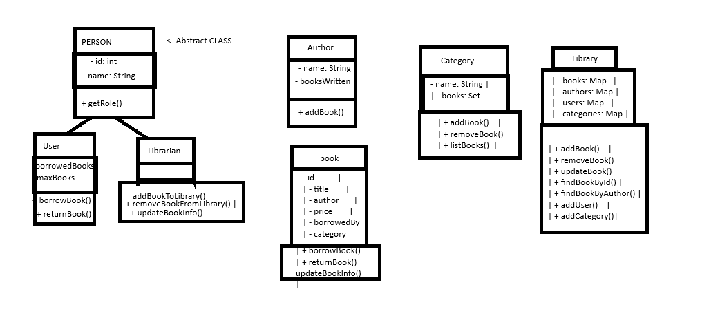

# Library Management System

A simple console-based library management system written in Java.

This project was developed to demonstrate object-oriented programming concepts using book, author, category, user, and library classes.

## Features

- Adding, updating, and deleting books
- Listing books
- Adding categories
- Listing books by category
- Adding users
- Borrowing and returning books
- Initialisation with sample book data

## Project Structure

.
├── docs/
│   ├── challenge1.png
│   └── class-diagram.png
├── src/
│   └── notes/
│       ├── Author.java
│       ├── Book.java
│       ├── Category.java
│       ├── Librarian.java
│       ├── Library.java
│       ├── Main.java
│       ├── Person.java
│       ├── SampleData.java
│       └── User.java
├── .gitignore
└── README.md

## UML Diagrams

Required system design:

Project class design:

## How to Run

To compile the project:

    javac -encoding UTF-8 -d out src/notes/*.java

To run the programme:

    java -cp out notes.Main

## Concepts Used

- Classes and objects
- Inheritance
- Abstract classes
- Encapsulation
- Collections
- Map, List, and Set
- Console-based user input
