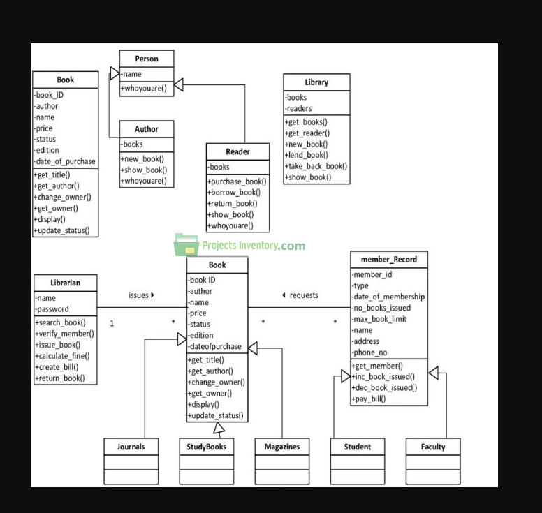

# Kutuphane Yonetim Sistemi

Java ile yazilmis basit bir konsol tabanli kutuphane yonetim sistemi.

Bu proje; kitap, yazar, kategori, kullanici ve kutuphane siniflariyla nesne yonelimli programlama mantigini gostermek icin hazirlanmistir.

## Ozellikler

- Kitap ekleme, guncelleme ve silme
- Kitaplari listeleme
- Kategori ekleme
- Kategoriye gore kitap listeleme
- Kullanici ekleme
- Kitap odunc alma ve iade etme
- Ornek kitap verileriyle baslama

## Proje Yapisi

```text
.
├── docs/
│   ├── challenge1.png
│   └── class-diagram.png
├── src/
│   └── notes/
│       ├── Author.java
│       ├── Book.java
│       ├── Category.java
│       ├── Librarian.java
│       ├── Library.java
│       ├── Main.java
│       ├── Person.java
│       ├── SampleData.java
│       └── User.java
├── .gitignore
└── README.md
```

## UML Diyagramlari

Istenen sistem:



Projedeki sinif tasarimi:


## Calistirma

Projeyi derlemek icin:

```bash
javac -encoding UTF-8 -d out src/notes/*.java
```

Programi calistirmak icin:

```bash
java -cp out notes.Main
```

## Kullanilan Konular

- Class ve object kullanimi
- Inheritance
- Abstract class
- Encapsulation
- Collection yapilari
- Map, List ve Set kullanimi
- Konsol uzerinden kullanici girisi
